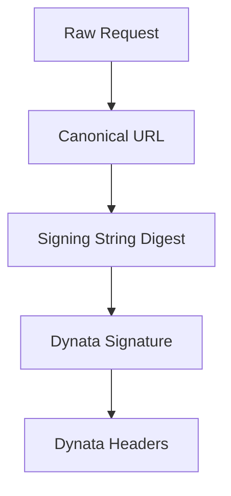
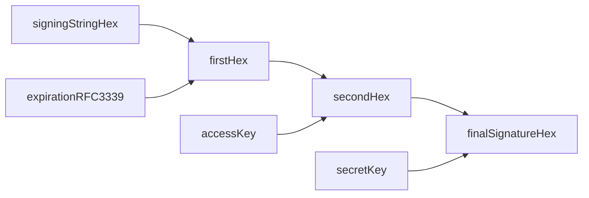

# dynata-sig-ts

TypeScript Dynata request signing SDK for embedded Node.js modules.

## Design Goals

- Minimal runtime footprint (Node built-ins only).
- Embedded-friendly (no global state, no background workers, no logging side effects).
- Behavior parity with Dynata Go/Java SDKs for canonical URL, signing string, and signature chain.
- Dual module output for interoperability (`import` and `require`).

## Installation

```bash
npm install @dynata/dynata-sig-ts
```

## Credentials

Before sending signed requests, obtain your credentials from Dynata:

- `access key`: used locally to compute `dynata-signature` and sent as `dynata-access-key`.
- `secret key`: never sent as a header; used locally to compute `dynata-signature`.

## Signing Pipeline



## 1) Canonical URL

Use `URLCanonizer.buildCanonicalUrl(url)`:

- Split at first `?` into path and raw query.
- Normalize the path.
- Keep only query tokens containing `=`.
- For duplicate keys, keep the last value.
- Decode then RFC 3986 percent-encode key/value with uppercase hex.
- Sort query keys lexicographically.
- Always append a `?` separator, even when query is empty.

## 2) Signing String

Use `SigningStringGenerator.generateSigningString(method, canonicalUrl, rawBody)`:

```text
SHA256_HEX(UTF8(method + canonicalUrl + rawBody))
```

Output is lowercase hex.

## 3) Signature

Use `DynataRequestSigner.generateSigningHeaders(...)`.

The HMAC chain is:



Equivalent steps:

1. `first = HMAC_SHA256_HEX(key = expirationRFC3339, message = signingString)`
2. `second = HMAC_SHA256_HEX(key = accessKey, message = first)`
3. `final = HMAC_SHA256_HEX(key = secretKey, message = second)`

Each round output is lowercase hex text, and the next round consumes those text bytes.

## Usage (ESM)

```ts
import { DynataRequestSigner } from "@dynata/dynata-sig-ts";

const signer = new DynataRequestSigner("YOUR_ACCESS_KEY", "YOUR_SECRET_KEY");

const body = JSON.stringify({ identifier: "jrn:iam:user:test" });
const headers = signer.generateSigningHeaders(
  "POST",
  "https://example.dynata.com/authorize",
  body,
  "2025-12-31T23:59:59.000Z"
);

const requestHeaders: Record<string, string> = {};
headers.applyHeaders(requestHeaders);
```

## Usage (CommonJS)

```js
const { DynataRequestSigner } = require("@dynata/dynata-sig-ts");

const signer = new DynataRequestSigner("YOUR_ACCESS_KEY", "YOUR_SECRET_KEY");
const headers = signer.generateSigningHeadersWithDefaultExpiration(
  "POST",
  "https://example.dynata.com/authorize",
  "{}"
);
```

## Emitted Headers

- `dynata-access-key`
- `dynata-signature`
- `dynata-expiration`

## Testing

```bash
npm test
```

## Build

```bash
npm run build
```
